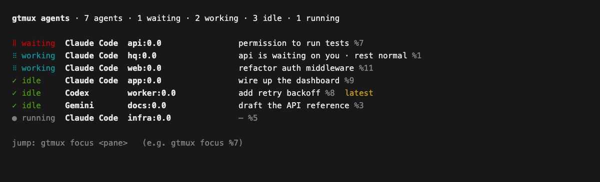
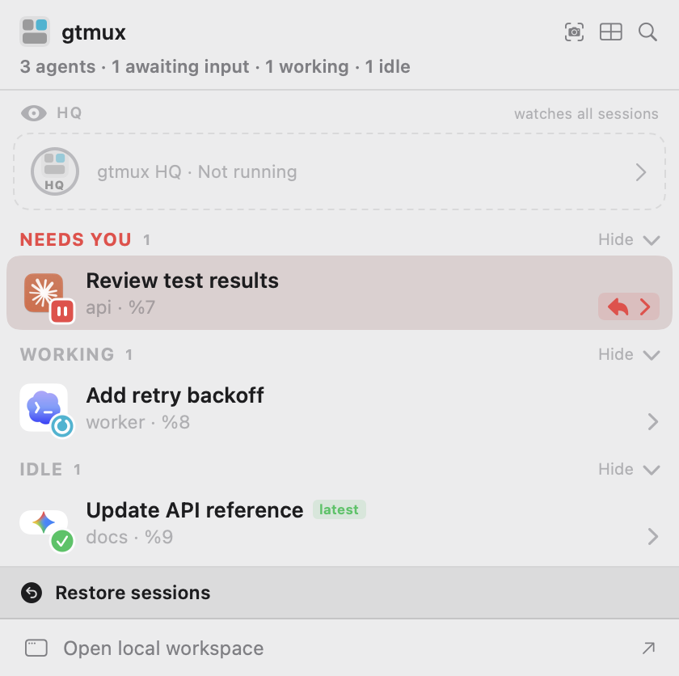
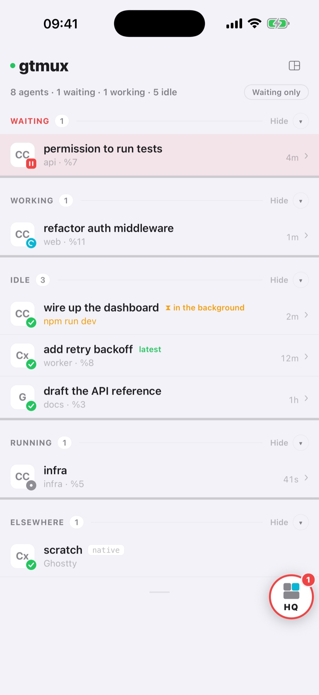
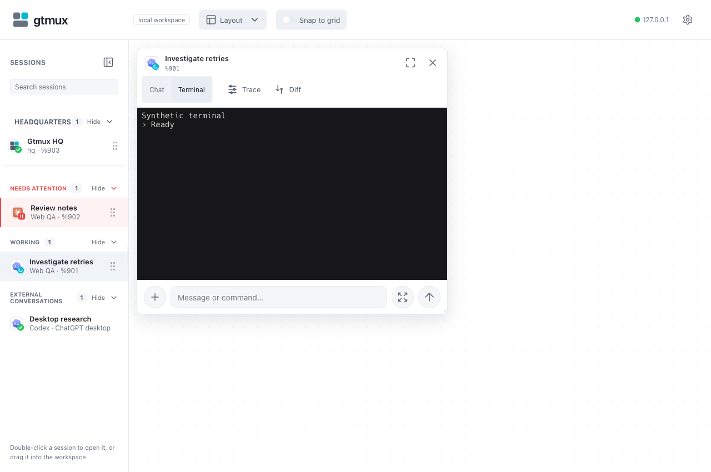

<div align="center">


# gtmux

Monitor tmux sessions and coding agents, locally or remotely.

[](https://github.com/chenchaoyi/gtmux/releases)
[](https://github.com/chenchaoyi/gtmux/actions/workflows/ci.yml)
[](go.mod)
[](LICENSE)

**English** · [中文](README.zh.md)

</div>

gtmux shows which coding agents in tmux are working, waiting for a reply or finished. Open a session on your Mac, or continue from your phone, iPad, browser or another terminal. Existing tmux sessions are detected; agents do not need to be launched through gtmux.

New here? Follow the three steps below on the computer running your agents. Then [choose an interface](#use-gtmux) for everyday work.

<a id="getting-started" data-doc-heading="Get connected"></a><a id="quickstart" data-doc-heading="1. Download and install"></a>

## Get connected

### 1. Download and install

On a Mac, use the official installer to get both the CLI and the menu-bar app:

```sh
curl -fsSL https://ccy.dev/gtmux/install | bash
```

In mainland China, use `https://ccy.pub/gtmux/install` in the same command. Both domains provide the same signed releases. The installer verifies the release metadata and packages, installs the CLI in `~/.local/bin` and opens the app. If `gtmux` is not found afterwards, follow the installer's PATH instructions.

For Homebrew, individual downloads, pinned versions or CLI-only installation, see [install options](docs/install.md).

You also need [tmux](https://github.com/tmux/tmux/wiki/Getting-Started) and an installed, signed-in coding agent. On macOS, `brew install tmux` installs tmux. The CLI/server supports macOS and Linux on amd64/arm64; the menu-bar app, desktop focus and lid controls require macOS.

<a id="configuration" data-doc-heading="2. Configure with doctor"></a>

### 2. Configure with doctor

In your Mac's terminal, run:

```sh
gtmux doctor
```

It checks your environment first. If repairs are available, answer **Review available repairs now?** to walk through them, or run `gtmux doctor --fix` directly. Each step explains its change and asks before applying it. Depending on what is missing, it configures tmux titles, session snapshots and autosave, hooks for installed agents, and the menu-bar app. Permissions or dependencies that need a separate action remain in the report.

If no tmux server is running, start a session with `tmux new -s work`, then retry the repair from there. Run `gtmux doctor` again afterwards: resolve **✗** failures first, review **⚠** recommendations for the features you use, and look for **✓** on the relevant checks. A hook marked **Configured** takes effect when the agent next starts; it does not restart running agents. [Doctor details and troubleshooting](docs/install.md#configure-with-doctor).

### 3. Connect your phone or browser

Keep the host awake and connected. For access outside your local network, run this on the Mac and leave it running:

```sh
gtmux tunnel
```

On first use, follow its prompts to install the optional tunnel client if needed. It starts the required server and prints a pairing QR. If you only need the same local network, use `gtmux serve` instead, then run `gtmux pair` in a second terminal for the QR. For an existing connection, `gtmux pair` also generates a fresh code. Each code works once and expires after five minutes.

On your iPhone or iPad, install [gtmux from the App Store](https://apps.apple.com/us/app/gtmux/id6791144062), then tap **Add a server → Scan pairing QR**. Scan the Mac's QR and open the saved server. Seeing its radar confirms the connection. To connect your own browser, open the browser link printed by `gtmux pair`; generate another code for each device.

You can also enable access through **Preferences → Remote access** in the Mac menu-bar app and open **Pair a device…**. Choose **Local network** for devices that can reach each other, or **Anywhere** for other networks. [Connection methods and fixes](docs/phone.md) explain blocked networks, persistent access and notification requirements. Pair your own devices; give collaborators a scoped [Share link](docs/guides/phone-and-web.md#open-one-pane-to-a-collaborator).

<a id="main-features" data-doc-heading="Use gtmux"></a><a id="five-ways-in" data-doc-heading="Use gtmux"></a><a id="guides" data-doc-heading="Use gtmux"></a><a id="what-it-looks-like" data-doc-heading="Use gtmux"></a>

## Use gtmux

Open any screenshot to view it at full size.

<a id="the-radar" data-doc-heading="Terminal: inspect and attach"></a>

### Terminal: inspect and attach

Use the terminal when you want a compact status list or a full tmux session. Run each agent in its own pane, for example `tmux new -s api 'claude'`, then open another terminal for the radar:

```sh
gtmux agents --watch
```

Select a row with ↑/↓ and press Enter to open its pane. Red means waiting for you, cyan working, green idle, and grey an agent whose turn state is unknown. Desktop focus supports Ghostty 1.3+, iTerm2 and cmux; Warp is best effort. [Run agents, read status and restore sessions](docs/guides/watch-a-fleet.md).

[](docs/guides/img/terminal-agents-en.png)

<details>
<summary>Text version of the terminal example</summary>

```text
gtmux agents · 7 agents · 1 waiting · 2 working · 3 idle · 1 running

‖ waiting  Claude Code  api:0.0                permission to run tests %7
⠿ working  Claude Code  hq:0.0                 api is waiting on you · rest normal %1
⠿ working  Claude Code  web:0.0                refactor auth middleware %11
✓ idle     Claude Code  app:0.0                wire up the dashboard %9
✓ idle     Codex        worker:0.0             add retry backoff %8  latest
✓ idle     Gemini       docs:0.0               draft the API reference %3
● running  Claude Code  infra:0.0              — %5

jump: gtmux focus <pane>   (e.g. gtmux focus %7)
```

</details>

To work from another computer, install the CLI there and run the `gtmux attach '…'` command printed by `gtmux pair` on the host. Later, use `gtmux attach <host>` and choose a pane. Detach with `Ctrl-]` or tmux's `Ctrl-b d`; the remote session keeps running. [Remote terminal walkthrough](docs/guides/attach-from-anywhere.md).

<a id="hq-the-supervisor" data-doc-heading="Terminal: inspect and attach"></a>

For a summary across sessions, run `gtmux digest`. To have an agent coordinate tasks, start `gtmux hq`; it uses one of your installed agent CLIs and its account. [Coordinate work with HQ](docs/guides/hq-supervisor.md).

### Mac menu bar: open the session that needs you

Run `gtmux app`, then click its menu-bar mark or press `⌘⌥G`. Select a tmux agent to open its terminal pane. Desktop notifications also open the matching pane; the app must be running and macOS must allow notifications.

[](docs/guides/img/menubar-agents-en.png)

The image shows the native menu-bar view with example sessions, captured on 2026-10-30. The bottom action opens the local browser workspace. `⌥⌘4` captures an image you can annotate and send to an agent. [Menu-bar actions and session focus](docs/guides/watch-a-fleet.md#jump-to-the-one-that-is-waiting).

### iPhone: reply away from your desk

After [connecting your device](#3-connect-your-phone-or-browser), tap an agent on the radar to read its conversation or terminal. Choose an offered reply or write your own. Enable iOS notifications to receive alerts when an agent needs you or finishes.

<a href="docs/guides/img/watch-a-fleet-radar-en.jpg"></a>

[Phone controls, notifications and sharing](docs/guides/phone-and-web.md#use-the-app) cover replies, attachments and access for collaborators.

### iPad: keep sessions side by side

Install the same App Store app and pair the iPad with its own fresh QR. In a wide window, keep the radar in the sidebar and select sessions in the main area. Open **All panes** to include shells and editors. Narrow windows use the phone layout.

[](docs/guides/img/watch-a-fleet-panes-en.jpg)

[The app guide](docs/guides/phone-and-web.md#use-the-app) explains the shared controls. The iPhone and iPad images use example sessions captured in the app simulator on 2026-10-08.

### Web: open the workspace in a browser

On your Mac, choose **Open local workspace** at the bottom of the menu-bar panel. It opens a paired browser on this Mac without a tunnel. From another device, open the fresh browser pairing link from [step 3](#3-connect-your-phone-or-browser).

[](docs/guides/img/web-workspace-en.png)

Double-click a tmux row or drag it onto the board. Choose **Chat**, **Terminal** or **Trace** for that session. Enter adds a line; Ctrl/Cmd+Enter sends. External sessions can be read where supported but do not accept pane input. [Browser controls and layout](docs/guides/phone-and-web.md#browser-controls).

<a id="docs" data-doc-heading="Reference"></a>

## Reference

- [Install, update and uninstall](docs/install.md): PATH, Homebrew, pinned versions and moving to a new Mac.
- [Connection troubleshooting](docs/phone.md): network choices, persistent tunnels, pairing, permissions and push delivery.
- [Agent setup and support](docs/guides/agent-integrations.md): hooks, history readers and each agent's limits.
- [CLI reference](docs/cli.md): command options, language and persistent settings.
- [HQ knowledge base](docs/knowledge.md): records, knowledge and your own rules.
- [DeepSeek Harness setup](docs/guides/deepseek-harness.md): terminal and history integration.

For development, see [CONTRIBUTING.md](CONTRIBUTING.md) and the [design documents](docs/design/README.md).

## License

[MIT](LICENSE) © ccy
