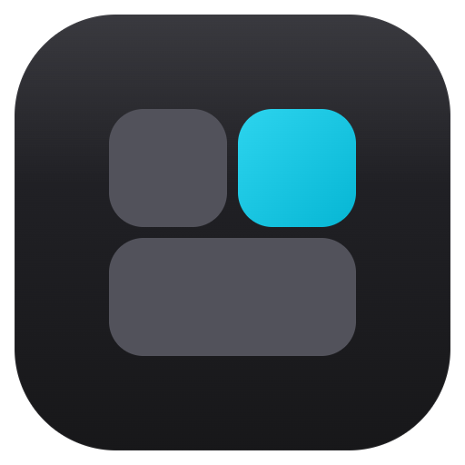
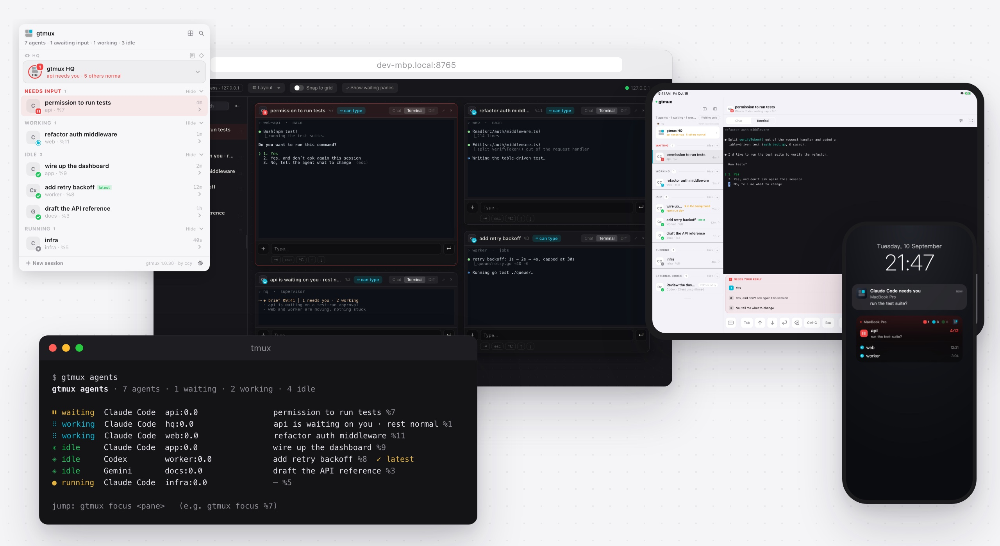
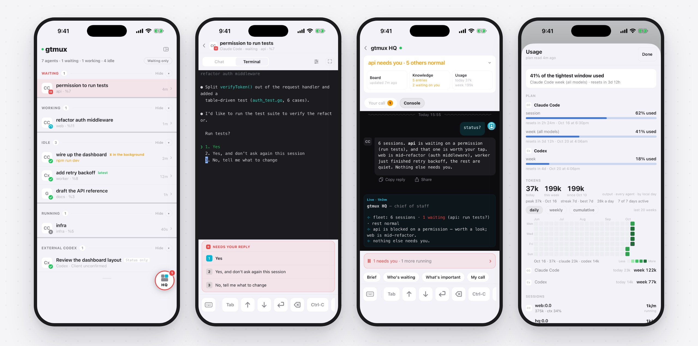

<div align="center">



# gtmux

Monitor tmux sessions and coding agents, locally or remotely.

[](https://github.com/chenchaoyi/gtmux/releases)
[](https://github.com/chenchaoyi/gtmux/actions/workflows/ci.yml)
[](go.mod)
[](LICENSE)

**English** · [中文](README.zh.md)

</div>

<picture>
  <source media="(prefers-color-scheme: dark)" srcset="docs/assets/readme-hero-dark.jpg" />
  
</picture>

gtmux shows the state of coding agents running in tmux, including Claude Code, Codex, Gemini and Cursor. See which are working, waiting for input or finished, then open a pane to continue. It also detects agents in existing tmux sessions; you do not need to launch them through gtmux.

gtmux assumes each agent runs in its own tmux pane. We recommend
[Ghostty](https://ghostty.org) + tmux + gtmux, and if tmux is new to you, start with its
[Getting Started](https://github.com/tmux/tmux/wiki/Getting-Started) guide.

Start with [installation](#quickstart), choose your [configuration](#configuration), then explore [main features](#main-features), [guides](#guides) and the [reference](#reference).

## Getting started

### Quickstart

The install script sets up the CLI and the menu-bar app, which delivers the desktop
notifications.

```sh
curl -fsSL https://ccy.dev/gtmux/install | bash
```

The other official entry is `https://ccy.pub/gtmux/install`. The short installer
verifies signed release metadata; GitHub keeps the original release packages.

With Homebrew, use `brew install chenchaoyi/tap/gtmux` for the CLI and
`brew install --cask chenchaoyi/tap/gtmux-app` for the menu-bar app.

Run the health check to configure agent hooks, the set-titles option used by focus and restore, session recovery after reboot and the menu-bar app. It asks before each change.

```sh
gtmux doctor
```

The menu-bar dot indicates whether an agent needs a reply. Click a notification to open its pane, or use `⌘⌥G` to jump to a waiting agent. You can also use the CLI:

```sh
gtmux agents --watch         # live dashboard in the terminal; Enter jumps to a pane
gtmux app                    # launch the menu-bar app (alias: menubar)
gtmux update                 # update the CLI and the menu-bar app
```

With the menu-bar app installed and running, `gtmux install hooks` registers the agent hook for notifications (add
`--agent codex|cursor|gemini|copilot|kiro|opencode|kimi|dsh` for another agent, or `--agent auto` to detect supported installations).

To use your phone, run `gtmux serve` on a reachable local network, or `gtmux tunnel`
for an HTTPS address reachable from other networks without a VPN, then pair the iOS
app. The networks still need to permit that connection. See [docs/phone.md](docs/phone.md).

Jumping to a pane (`focus`, `restore`, `new`) needs macOS with
[Ghostty](https://ghostty.org) 1.3+, iTerm2, or cmux; Warp works on a best-effort basis. `agents`
and `overview` work in any terminal that hosts tmux. From mainland China, or with
unreliable GitHub access, see the [install notes](docs/install.md).

### Host platforms

The cgo-free CLI/server supports **macOS and Linux (amd64/arm64)**. Run it beside your tmux sessions and connect from the phone, iPad or browser. The menu-bar app, desktop focus and lid controls are macOS features. See the [Linux setup guide](docs/linux.md) for same-user sockets, systemd and headless operation.

DeepSeek Harness sessions retain one identity across Web and supported terminal clients. The dst adapter adds verified pane management and native addressed input; see the [DSH guide](docs/guides/deepseek-harness.md). Web conversations remain read-only external histories
on the menu bar, phone, iPad, Web and CLI. A dedicated native Cordis plugin adds
future lifecycle events; TUI control is not included. See [DSH setup and limits](docs/guides/deepseek-harness.md).

- [Install notes](docs/install.md): pinning a version, mirrors and source builds.
- [Linux setup](docs/linux.md): run the host without a desktop.

## Configuration

Most setup starts with `gtmux doctor` in [Quickstart](#quickstart). Then choose what you need:

- [Language and persistent settings](docs/cli.md#gtmux-config-the-few-settings-that-are-not-per-run-flags): inspect and change the settings shared by gtmux processes.
- [Agent setup and hooks](docs/guides/agent-integrations.md): connect the agents you use and understand their support limits.
- [Remote access](docs/phone.md): choose a connection, pair devices and set permissions before using the phone or browser.

Once configured, follow [the radar](#the-radar) for daily use, or [the guides](#guides) for a complete walkthrough.

## Main features

### Five ways in

- In the terminal, `gtmux agents` lists every agent, `focus` jumps to a pane and `spawn` hands an agent a task.
- The menu-bar app keeps a status dot in view, opens a `⌘⌥G` palette, posts a desktop notification when an agent needs you, and with `⌥⌘4` takes a screenshot you can mark up and send to an agent.
- The iPhone and iPad app ([App Store](https://apps.apple.com/app/id6791144062)) adds lock-screen push and replies typed into a pane, and can hand a collaborator chosen panes through a scoped link.
- The web view opens your radar and panes in any browser. You can type where your device or a guest link has permission.
- From another computer, `gtmux attach` brings a tmux session from your server into the local terminal.

Every remote path needs its host running. On macOS, `gtmux awake on` keeps it running with the lid
closed after one admin authorization, so an already configured serve and tunnel can
keep answering. On battery, it warns at 30% and restores sleep at 20%; it does not
start remote access for you. A bare `gtmux awake` reports the current state.

### The radar

```
gtmux agents · 7 agents · 1 waiting · 2 working · 3 idle · 1 running

‖ waiting  Claude Code  api:0.0                permission to run tests %7
⠿ working  Claude Code  hq:0.0                 api is waiting on you · rest normal %1
⠿ working  Claude Code  web:0.0                refactor auth middleware %11
✓ idle     Claude Code  app:0.0                wire up the dashboard %9
✓ idle     Codex        worker:0.0             add retry backoff %8  latest
✓ idle     Gemini       docs:0.0               draft the API reference %3
● running  Claude Code  infra:0.0              — %5

jump: gtmux focus <pane>   (e.g. gtmux focus %7)
```

Rows are sorted by urgency. The apps use the same states in colour: red is waiting for
you, cyan is working, green is idle, and grey is an identified agent process whose turn state is not known.

Agents with the gtmux hook (a small callback the agent runs at the start and end of each
turn) report their state directly. Inside tmux, gtmux recognises agents from their
command, title and process tree; screen and CPU sampling can supply state when no
hook reports it. Outside tmux, hooks provide read-only observations; dedicated
Codex and DSH readers can also discover saved histories without hooks. Eligible idle,
resumable non-Codex conversations with saved messages can move into tmux through
`gtmux adopt <id>`; external Codex and DSH conversations cannot be adopted.

### HQ, the supervisor

`gtmux digest` shows what each agent is working on: your last prompt, the end of its
last reply, and what it's asking when it waits. It makes no model calls. `gtmux hq`
starts HQ in its own agent session. HQ reads the digest and events, coordinates other
agents and is woken when one starts waiting. You can give HQ instructions for work
across several sessions and review the actions it takes.

### What it looks like

<picture>
  <source media="(prefers-color-scheme: dark)" srcset="docs/assets/readme-screens-dark.jpg" />
  
</picture>

## Guides

Walkthroughs with screenshots, one task each:

- [Monitor coding agents in tmux](docs/guides/watch-a-fleet.md): run agents in tmux, read the radar, jump to the one waiting.
- [Coordinate tasks with HQ](docs/guides/hq-supervisor.md): start HQ and configure event notifications, decision scope, task dispatch, knowledge and migration.
- [Use your phone, iPad and browser](docs/guides/phone-and-web.md): pair your own devices, reply to agents and share selected panes.
- [Attach to your Mac from any computer](docs/guides/attach-from-anywhere.md): connect a terminal on another computer to a tmux session on your Mac.

<a id="docs"></a>

## Reference

- [How each agent connects](docs/guides/agent-integrations.md): built-in integrations, event bridges, history sources, setup and limits.
- [CLI and commands](docs/cli.md): every command, HQ, detection, per-agent hooks, tmux key bindings.
- [Remote access reference](docs/phone.md): connection methods, permissions, notifications and troubleshooting.
- [HQ knowledge base](docs/knowledge.md): the knowledge base, the three layers, and what you can change.
- [Install notes](docs/install.md): pinning a version, building from source, mirrors.
- [DeepSeek Harness](docs/guides/deepseek-harness.md): setup, shared identity and control limits.
- [Design docs](docs/design/README.md), with in-flight changes in `openspec/`.

The repo map and contributor notes are in [CONTRIBUTING.md](CONTRIBUTING.md).

## License

[MIT](LICENSE) © ccy
