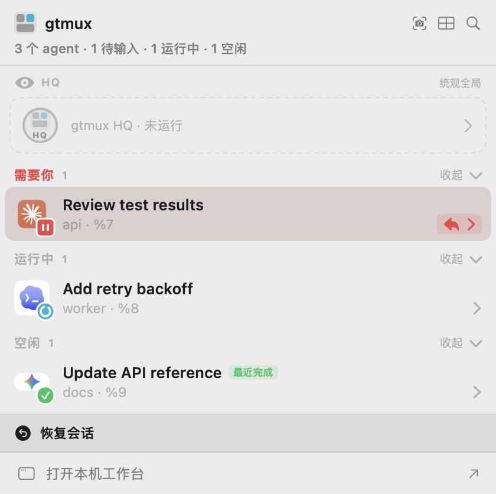
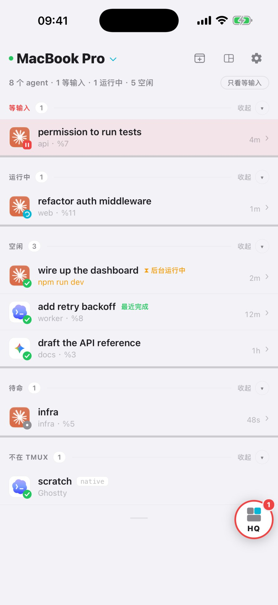
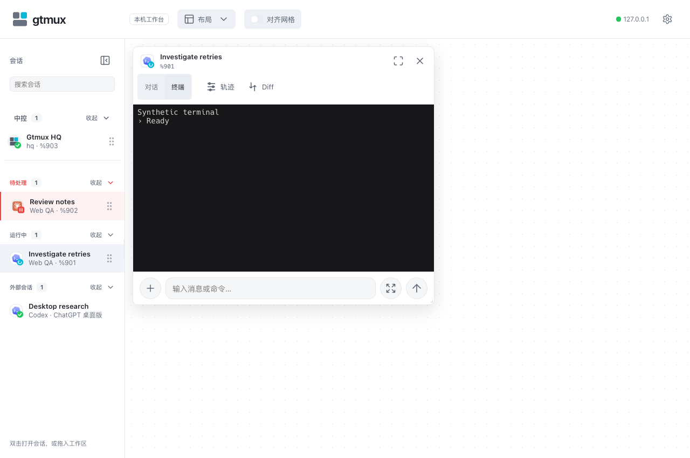

<div align="center">


# gtmux

集中查看 tmux 会话和 coding agent 的状态，并在本机或远程操作。

[](https://github.com/chenchaoyi/gtmux/releases)
[](https://github.com/chenchaoyi/gtmux/actions/workflows/ci.yml)
[](go.mod)
[](LICENSE)

[English](README.md) · **中文**

</div>

gtmux 集中显示 tmux 中 coding agent 的状态：正在工作、等待回复或已经完成。你可以在 Mac 上打开对应会话，也可以从手机、iPad、浏览器或另一台电脑的终端继续操作。已有的 tmux 会话会自动识别，无需通过 gtmux 启动 agent。

第一次使用，先在运行 agent 的电脑上完成下面三步，再[选择日常使用的入口](#选择你的入口)。

<a id="开始使用" data-doc-heading="安装并连接"></a><a id="快速上手" data-doc-heading="1. 下载并安装"></a>

## 安装并连接

### 1. 下载并安装

在 Mac 终端运行官方安装器，同时安装 CLI 和菜单栏 App：

```sh
curl -fsSL https://ccy.pub/gtmux/install | bash
```

也可将命令中的地址换成 `https://ccy.dev/gtmux/install`，两个入口提供同一套签名发行包。安装器会验证发行清单和文件，把 CLI 装到 `~/.local/bin`，并打开菜单栏 App。装完找不到 `gtmux` 时，按安装器提示将该目录加入 PATH。

使用 Homebrew、手动下载、指定版本或只安装 CLI，见[安装选项](docs/install.zh.md)。

还需要 [tmux](https://github.com/tmux/tmux/wiki/Getting-Started)，以及已安装、已登录的 coding agent。macOS 可用 `brew install tmux` 安装 tmux。CLI／服务端支持 macOS 和 Linux 的 amd64、arm64；菜单栏 App、桌面跳转和合盖控制仅适用于 macOS。

<a id="配置" data-doc-heading="2. 用 doctor 配置"></a>

### 2. 用 doctor 配置

安装后，在 Mac 终端运行：

```sh
gtmux doctor
```

doctor 先检查环境。有可修复项时，回答「现在查看可修复项？」后逐项配置；也可直接运行 `gtmux doctor --fix`。每一步都会先解释改动，再询问是否应用。它会按本机情况补齐 tmux 标题、会话快照与自动保存、已安装 agent 的 hook、菜单栏 App 等设置；需要单独处理的权限或依赖会列出下一步。

如果提示没有 tmux 服务，先用 `tmux new -s work` 创建会话，再从里面运行修复。结束后重新跑 `gtmux doctor`：先处理 **✗**，再按所需功能处理 **⚠**，**✓** 表示该项检查通过。hook 显示「已配置」不代表运行中的 agent 已加载，下次正常启动 agent 后才会生效。[doctor 说明与排障](docs/install.zh.md#用-doctor-配置)。

### 3. 连接手机或浏览器

保持主机唤醒、联网。需要从其他网络访问时，在 Mac 终端运行，并保持它运行：

```sh
gtmux tunnel
```

首次运行时，按提示安装所需的隧道组件。它会启动所需服务并打印配对二维码。只在同一局域网使用时，改用 `gtmux serve`，再在另一个终端运行 `gtmux pair` 获取二维码。已有连接也可用 `gtmux pair` 生成新码。每个码只能用一次，5 分钟过期。

在 iPhone 或 iPad 从 [App Store](https://apps.apple.com/cn/app/gtmux/id6791144062) 安装 gtmux，点「添加服务器 → 扫描配对二维码」，扫描 Mac 上的码，再打开保存的服务器。看到雷达即表示已连通。连接自己的浏览器时，打开 `gtmux pair` 打印的浏览器链接；每台设备都要生成新码。

也可在 Mac 菜单栏 App 的「偏好设置 → 远程访问」开启连接，再打开「配对设备…」。设备在同一可互通网络时选「局域网」，跨网络时选「任意网络」。网络不通、需要常驻连接或收不到通知，见[连接方式与排障](docs/phone.zh.md)。自己的设备用配对；给协作者用限定范围的[分享链接](docs/guides/phone-and-web.zh.md#把一个-pane-开给协作者)。

<a id="主要能力" data-doc-heading="选择你的入口"></a><a id="五个入口" data-doc-heading="选择你的入口"></a><a id="上手指南" data-doc-heading="选择你的入口"></a><a id="长什么样" data-doc-heading="选择你的入口"></a>

## 选择你的入口

点击截图可查看原图。

<a id="雷达" data-doc-heading="终端：查看状态和接回会话"></a>

### 终端：查看状态和接回会话

需要紧凑的状态列表，或要完整操作 tmux 会话时，用终端。每个 agent 各占一个 pane，例如用 `tmux new -s api 'claude'` 启动，再另开终端查看雷达：

```sh
gtmux agents --watch
```

用 ↑/↓ 选择，按回车打开 pane。红色在等你，青色正在工作，绿色空闲，灰色表示已识别 agent、但回合状态未知。桌面跳转支持 Ghostty 1.3+、iTerm2 和 cmux；Warp 尽力支持。[启动 agent、查看状态与恢复会话](docs/guides/watch-a-fleet.zh.md)。

[](docs/guides/img/terminal-agents-zh.png)

<details>
<summary>终端示例的文字版</summary>

```text
gtmux agent · 7 agent · 1 等输入 · 2 运行中 · 3 空闲 · 1 只有 shell

‖ 等输入   Claude Code  api:0.0                permission to run tests %7
⠿ 运行中   Claude Code  hq:0.0                 api is waiting on you · rest normal %1
⠿ 运行中   Claude Code  web:0.0                refactor auth middleware %11
✓ 空闲     Claude Code  app:0.0                wire up the dashboard %9
✓ 空闲     Codex        worker:0.0             add retry backoff %8  最近完成
✓ 空闲     Gemini       docs:0.0               draft the API reference %3
● 运行中   Claude Code  infra:0.0              — %5

跳转：gtmux focus <pane>   （例如 gtmux focus %7）
```

</details>

从另一台电脑操作时，在那台电脑安装 CLI，执行主机上 `gtmux pair` 打印的 `gtmux attach '…'` 命令。以后用 `gtmux attach <host>` 选择 pane。按 `Ctrl-]` 或 tmux 的 `Ctrl-b d` 断开，远端会话继续运行。[远程终端操作](docs/guides/attach-from-anywhere.zh.md)。

<a id="hq中控" data-doc-heading="终端：查看状态和接回会话"></a>

需要跨会话摘要时，运行 `gtmux digest`；需要一个 agent 协调任务时，运行 `gtmux hq`，它使用你已安装的 agent CLI 和对应账号。[用 HQ 协调任务](docs/guides/hq-supervisor.zh.md)。

### Mac 菜单栏：打开等待回复的会话

运行 `gtmux app`，点击菜单栏标记或按 `⌘⌥G` 打开面板。选择 tmux agent，即可切到对应终端 pane。桌面通知也能打开对应 pane，需要 App 保持运行，并允许 macOS 通知。

[](docs/guides/img/menubar-agents-zh.png)

图为 2026-10-30 使用示例会话采集的原生菜单栏，底部可以打开浏览器工作台。按 `⌥⌘4` 可以截图、标注并发送给 agent。[菜单栏操作与会话跳转](docs/guides/watch-a-fleet.zh.md#跳到在等你的那个)。

### iPhone：离开电脑后回复

[连上设备](#3-连接手机或浏览器)后，点雷达中的 agent，阅读对话或终端，选择给出的答案或输入回复。允许 iOS 通知后，可以在 agent 等你或完成时收到提醒。

<a href="docs/guides/img/watch-a-fleet-radar-zh.jpg"></a>

回复、附件、通知和协作者权限，见[手机操作与分享](docs/guides/phone-and-web.zh.md#在-app-里操作)。

### iPad：并排查看会话

安装同一个 App Store App，为 iPad 生成新码配对。宽窗口下，雷达留在侧栏，选中的会话显示在主区。打开「所有 pane」还可以看到 shell 和编辑器；窄窗口使用手机布局。

[](docs/guides/img/watch-a-fleet-panes-zh.jpg)

共用操作见 [App 指南](docs/guides/phone-and-web.zh.md#在-app-里操作)。iPhone 和 iPad 图使用 App 模拟器中的示例会话，采集于 2026-10-08。

### Web：在浏览器打开工作台

在 Mac 菜单栏面板底部选择「打开本机工作台」，会在本机浏览器直接打开已配对的工作台，无需隧道。从另一台设备访问时，打开[第 3 步](#3-连接手机或浏览器)生成的新浏览器配对链接。

[](docs/guides/img/web-workspace-zh.png)

双击 tmux 行或将它拖入看板，再选择「对话」「终端」或「轨迹」。回车换行，Ctrl/Cmd+回车发送。支持读取的外部会话可以查看，但不能向 pane 输入。[浏览器操作与布局](docs/guides/phone-and-web.zh.md#网页操作)。

<a id="docs" data-doc-heading="按需查阅"></a><a id="参考" data-doc-heading="按需查阅"></a>

## 按需查阅

- [安装、更新与卸载](docs/install.zh.md)：PATH、Homebrew、指定版本和换 Mac。
- [连接排障](docs/phone.zh.md)：网络选择、常驻隧道、配对、权限与通知。
- [Agent 接入与支持范围](docs/guides/agent-integrations.zh.md)：hook、历史读取及各 agent 的边界。
- [CLI 参考](docs/cli.zh.md)：命令参数、语言与持久设置。
- [HQ 知识库](docs/knowledge.zh.md)：档案、知识和你自己的规则。
- [DeepSeek Harness 接入](docs/guides/deepseek-harness.zh.md)：终端和历史集成。

参与开发可看 [CONTRIBUTING.md](CONTRIBUTING.md) 和[设计文档](docs/design/README.zh.md)。

## 许可

[MIT](LICENSE) © ccy
