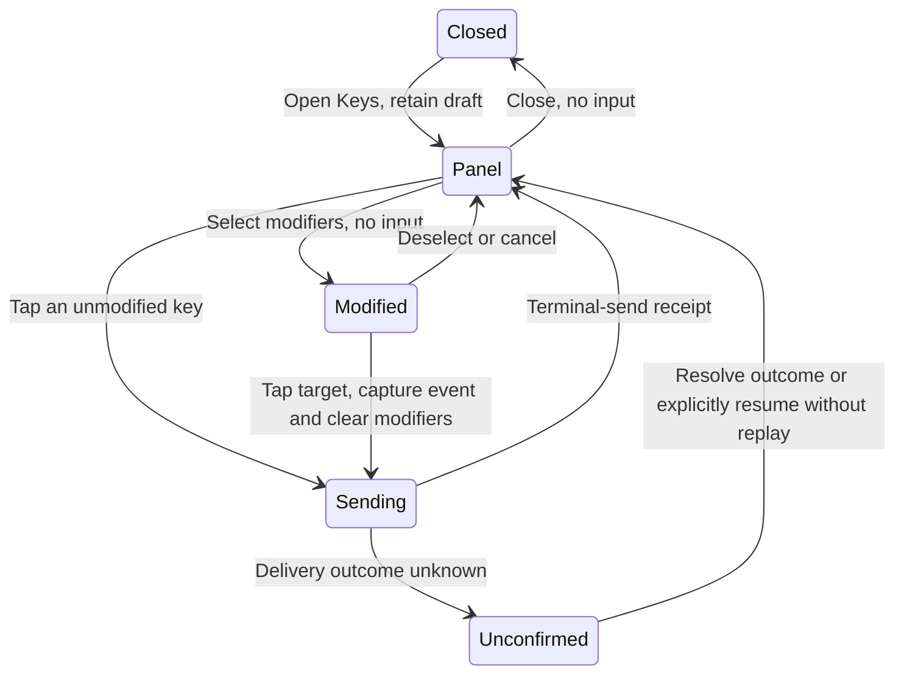

# Terminal keys: research, design and implementation

Status: **implemented in the feature branch; not released**. Researched 2026-10-19 against repository
`7fc531ffd50b40d034771b220f427a03b25d0ed4`, local tmux 3.7c and Codex source
`rust-v0.163.0`. [中文](terminal-keyboard-research.zh.md).
Implementation record: [OpenSpec change](../../openspec/changes/archive/2026-10-19-terminal-keyboard-input/proposal.md).
The current [mobile](MOBILE.md), [web](WEB.md), [surface](SURFACES.md) and
[HTTP contract](../../api/contract.md) remain the authority for shipped behavior.

## Decision

Provide one **Keys** panel for navigation keys, F1–F12, shortcut characters and
Ctrl/Alt/Shift combinations. Keep the existing frequent-key row, add one visible
Keys entry next to the keyboard toggle, and offer contextual actions such as
**View question** only when the core has current evidence for them.

The shared core owns the key catalog, combination rules and tmux conversion.
Clients render capabilities; agents contribute meaning, not separate key senders.
A new combination within supported families should require no transport patch.
A genuinely new key family or agent-specific action can still require an adapter
change. This is a bounded terminal keyboard, not a promise to forward every OS key.

## Research scope and evidence

Audience: people operating coding-agent terminals from a phone, plus iPad and web
users. Horizon: the next implementation, with a protocol that can grow afterward.
Evidence comes from the user's screenshot, source inspection, public first-party
documentation and an isolated byte-level experiment. No competitor app was installed
or operated, no usability study was run, and complaint frequency is unknown.

| Source | Observed evidence | Design judgment |
| --- | --- | --- |
| [Blink Smart Keys](https://docs.blink.sh/#smart-keys) and [customization](https://docs.blink.sh/basics/customize) | An accessory row provides modifiers, navigation and further keys; modifier holding supports sequences. | Borrow progressive disclosure. Keep remote terminal input separate from local app shortcuts. |
| [Prompt keyboard](https://help.panic.com/prompt/prompt-keyboard/) | An extra row opens a configurable keyboard with navigation and F1–F16. The page is dated 2023-10-30. | Borrow the visible panel entry, not a large always-visible keyboard. This is a documented pattern, not a verified current app walkthrough. |
| [Termux configuration](https://github.com/termux/termux-tools/blob/master/termux.properties) and [release record](https://github.com/termux/termux-app/releases) | Extra keys have declarative layouts and popup variants; releases document modifier locking. | Borrow a data-driven catalog. Defer macros, hidden swipe-only access and modifier locking from the first release. |
| [Apple button guidance](https://developer.apple.com/design/human-interface-guidelines/buttons) | Buttons need recognizable states and sufficient touch targets. | Keep targets at least 44 × 44 pt, with text/accessibility labels and a selected indicator in addition to color. |
| [Codex question handler](https://github.com/openai/codex/blob/rust-v0.163.0/codex-rs/tui/src/chatwidget/questions.rs), [keymap](https://github.com/openai/codex/blob/rust-v0.163.0/codex-rs/tui/src/keymap.rs), [question state](https://github.com/openai/codex/blob/rust-v0.163.0/codex-rs/tui/src/bottom_pane/async_questions/mod.rs) | Questions start collapsed. Shift+Left opens/navigates them and can also reach queued-message editing. Questions arriving do not take focus. | A semantic action needs current context; a permanent generic key remains available. Do not force expansion or introduce a new agent status. Defaults are version-specific and configurable. |
| [tmux manual](https://man.openbsd.org/tmux.1#send-keys), [input encoder](https://github.com/tmux/tmux/blob/master/input-keys.c) | Named keys become terminal input; unknown names can become literal text. Extended key encoding depends on application mode. | Accept structured, validated input; generate tmux names in one place. Never pass an arbitrary key string through. |

Termius was searched, but no suitable current first-party keyboard source was
verified. A mirrored third-party manual was excluded. The
[tmux modifier wiki](https://github.com/tmux/tmux/wiki/Modifier-Keys) explicitly
warns it is outdated from 3.5 onward, so it is not the authority for current defaults.
No claims are made about competitor market prevalence or current product superiority.

### Ranked problems

| Priority | User goal and failure | Evidence / confidence | Product response |
| --- | --- | --- | --- |
| P1 | Open Codex's folded question on a phone; the displayed chord has no button. | User screenshot + source, high; one reported case, population frequency unknown. | Contextual View question plus a generic key panel. |
| P1 | Use F2 or a new chord without waiting for another release. | Existing fixed client row and server allowlist lack them; source-confirmed, high. | A shared family-based catalog and advertised combinations. |
| P1 | Know that a key was sent, rather than accidentally insert its name. | Isolated unknown-name probe, high for tmux 3.7c; not an existing HTTP bypass, whose allowlist rejects it. | Reject unknown/unsupported events before any terminal side effect. |
| P2 | Reach many keys without losing the terminal or typing with a latched modifier. | Design risk, not a measured existing failure. | Separate panel, one-shot modifiers and preserved drafts. Validate on devices. |

## Existing implementation

- `mobileapp/src/ui/Composer.tsx` defines Tab, arrows, Return, Backspace, Ctrl-C
  and Esc as fixed controls. Its immediate touch feedback is not a delivery receipt.
- `internal/app/serve.go` has a fixed `allowedSendKeys` map. F2, BTab and S-Left
  are absent. `sendToPane` exits copy mode before validating a named key.
- `internal/tmux/tmux.go:SendKey` passes a named key as an argument to tmux.
- `internal/server/server.go:handleSend` enforces host consent, grant freshness
  and the particular guest link's pane input grant. This remains authoritative.
- `send_id` reaches the current API, but the named-key branch returns before
  the text-and-Enter deduplication logic. It is not currently safe to describe
  arbitrary control-key retries as deduplicated.

These observations are tied to the baseline above. This research changes none of
those code paths and does not expand into a general input-security audit.

## Interaction design

### Frequent row and panel

Keep existing controls in their established order. Insert **Keys / 按键** immediately
after the keyboard toggle so the new entry is visible without first discovering
horizontal scrolling. Do not add twelve function keys to the row or reorder controls
based on inferred usage. A contextual question action is a separate compact notice
above the composer, not another permanent status or a new full-width toolbar.

The Keys panel has a pane-identifying title, Close, a combination preview, three
modifier toggles (**Ctrl, Alt, Shift**) and three explicit categories:

| Category | Contents | Example |
| --- | --- | --- |
| Navigation | Four arrows, Home, End, Page Up/Down, Insert, Delete, Backspace, Tab, Esc, Enter, Space | Shift + Left |
| Function | F1–F12, normally four columns and three rows | Ctrl + F2 |
| Characters | A–Z, 0–9 and supported ASCII shortcut punctuation | Ctrl + K, Alt + B |

Remember the last category locally. Do not introduce a keyboard-layout editor or a
recents/pinning system in the first release. Those can later store the same structured
events without changing transport. Character buttons have explicit values; the
phone's IME text is never split into synthetic terminal keystrokes.

Opening the panel hides the software keyboard while preserving the pane's draft and
attachments. Closing restores focus only if that composer was active and the target
is still the same. Reading the terminal must not unexpectedly raise the keyboard.
Panel keys act on the remote application, not the phone's selection or scroll position.

### One-shot modifiers

1. Tap Ctrl/Alt/Shift to select any supported combination; tap again to deselect.
2. The preview shows the exact next event, for example **Ctrl + F2**. Selected
   modifiers have a check/selected state and accessibility announcement.
3. Tap a target key once to send one event. Capture the event, clear all selected
   modifiers immediately, and hold the send controls until its receipt or failure.
4. Unsupported combinations remain visible but disabled with an accessible reason.
   Selecting a modifier sends nothing. Dismissing, switching panes/hosts, backgrounding
   or losing input permission clears selections without sending.

No modifier locking, long-press auto-repeat, key sequences or macros in v1. Explicit
later taps can form a sequence; the initial interface does not silently queue keys
through a network failure. No offline replay. Enter is one explicit key; other events
never add Enter or submit the composer's saved text.



While an outcome is unconfirmed, the user may close or inspect the terminal; the UI
does not send later events. Offer Inspect terminal and Continue without retry, plus
a same-ID Retry only while boot/context/receipt retention make it safe. Resuming
input is an explicit user decision after inspection. It does not relabel the previous
event as safely unsent.

### Feedback, layout and accessibility

Use the existing `bg` / `surface` / `raised` hierarchy and text tokens. Selection
uses shape/text as well as contrast; it does not invent a new status color.
Local touch feedback acknowledges the tap. A successful receipt says **Sent to
terminal / 已发送到终端**, not “the agent executed it.” An ambiguous network failure
says **Result unconfirmed / 结果未确认**, retaining the exact event for any safe retry.

Phone: a bottom sheet, bounded by available height, with scrollable content and a
reachable title/Close. iPad: an anchored panel near the composer, maximum 480 pt
wide, falling back to the phone sheet in compact layouts. Function keys use four
columns when labels and 44 pt targets fit, fewer at large text sizes. Landscape and
keyboard changes may scroll content; never shrink hit targets to fit. VoiceOver reads
the combination, selected state, unavailable reason and send result. Focus returns
to the invoking Keys button. These are acceptance requirements, not verified layouts.

## Keys and compatibility

The first release supports the navigation/editing family above, F1–F12, ASCII
shortcut characters and validated Ctrl/Alt/Shift combinations. The catalog publishes
which modifier sets are valid per key. It is not the Cartesian product of every key
and every modifier. Examples of canonical normalization:

| Structured event | Generated tmux representation | Boundary |
| --- | --- | --- |
| F2 | `F2` | No appended Enter. |
| Shift + Left | `S-Left` | Codex's current default; not proof of its semantic meaning in every context. |
| Shift + Tab | `BTab` | Alias encoded centrally. |
| Ctrl + F2 | `C-F2` | App interpretation still depends on its binding. |
| Alt + Left | `M-Left` | UI Alt maps to terminal Meta, not a separate Esc request. |
| Shift + a | literal `A`, produced by the encoder | Never generate the unreliable name `S-a`; digits/punctuation use their explicit resulting character. |
| Ctrl + I / Ctrl + M | control bytes also used by Tab / Enter | Expose the equivalence; do not claim these are distinct in legacy mode. |

Distinguishing Ctrl+Shift+letter, Ctrl+digit and modified Return can require extended
key modes. Do not advertise such combinations until the core can establish and test
the relevant pane mode; unknown mode means unavailable. F13–F24, keypad/media keys,
Super/Cmd and OS-reserved shortcuts are outside v1. Do not modify users' tmux config,
force extended mode or intercept global shortcuts to manufacture support.

## Shared architecture and API

The cgo-free leaf module `internal/terminalkeys` is implemented, and owns the
catalog, normalizer, valid combinations, aliases and tmux encoder.
The existing frequent row, new panel and agent actions use it. Clients own layout,
icons and localization; they do not maintain separate permission/encoding matrices.

The authenticated, pane-scoped `GET /api/input-capabilities?id=%N` returns
schema version, server boot, an opaque pane-binding token, `can_input`, canonical keys,
valid modifier sets. Clients explain withheld combinations. Visibility is checked before
returning target information; capability metadata never grants input. Cache the catalog
by version/boot, fetch target context on entry/reconnect, and recheck on writes.
Do not poll a full catalog on every terminal frame.

Extend `/api/send` additively with a typed `key_event`. Example; copy the current context returned by discovery rather than constructing it:

```json
{
  "id": "%42",
  "key_event": {"key": "F2", "modifiers": ["control"]},
  "input_context": {"boot": "<boot>", "pane_binding": "<opaque token>", "expires_at": 1792400000, "proof": "<opaque proof>"},
  "send_id": "<unique event id>"
}
```

Canonical keys use `ArrowLeft`/`Backspace`/`PageUp` etc., `F1`–`F12` and explicit
single ASCII characters. Modifier values are `control`, `alt`, `shift`, canonicalized
in that order; duplicates and unknown values are invalid. Exactly one event form is
accepted: legacy `key`, `key_event`, a contextual `action`, or the existing text form.
New events cannot also carry text or `enter`. Keep the existing valid legacy contract;
do not reinterpret old text or silently turn a rejected event into literal text.
The new key/action forms require `send_id`; it remains optional for valid legacy forms.

The server checks scope/consent/grant freshness, event validity and target binding
before copy-mode exit or any write, then revalidates target identity immediately before
injection. Only the core generates the tmux argument. Do not expose raw bytes, arbitrary
tmux names/commands, repeat counts or shell fragments. A disconnected/native external
conversation without a verified pane route does not acquire input capability.

The new event path must deduplicate `send_id` by caller, boot, pane binding and payload,
including concurrent duplicates. Reusing an ID with a different event is rejected.
Permission is checked again before returning a cached receipt. Keep receipts bounded
and advertise their actual retry horizon. Bind retries to the same boot; after a boot
change or expired receipt, an ambiguous event is not replayed. A crash between injection
and receipt persistence remains uncertain: no exactly-once claim or automatic resend.
Serialize key sends per active client target; preserve any failed event separately
instead of replaying later operations against an uncertain UI state.

Use existing 401/403 responses for auth/grants, 400 for malformed/ambiguous events,
422 for an unsupported combination, and 409 for stale context or conflicting IDs.
New clients connecting to an older server retain only legacy controls; a missing
capability endpoint never authorizes optimistic new-key sends. Old clients retain
their existing valid requests against the new server.

## Agent-specific meaning

An agent adapter can expose an action ID, localized label, structured key event and
freshness precondition. **View question** appears only with a currently pending Codex
question and a verified binding. Clicking sends only the open-question key; it does
not choose an answer. No question means the semantic action is absent; the generic
Shift+Left remains available with its literal label. A stale action returns 409
instead of editing a queued message by accident. Proposed action requests carry
`action: {id, revision}` plus the same input context and send ID; the core re-resolves
the event, never trusts a client-supplied action-to-key mapping.

Use actual hooks/structured question events first **where the deployed harness exposes
them**. Source code for an internal Codex question state is not evidence that an external
hook or read-only subscription exists. If unavailable or known broken, one core adapter
may narrowly recognize the current terminal footer; do not scrape historic prose,
invent hidden option labels, start another app-server or resume a session to inspect it.
Unknown/custom keybindings suppress the semantic action rather than assert a default.
Pending async questions are supplemental attention information: working can continue,
so do not manufacture a blocking `waiting` state or a new status class.

Native answer cards, question-ID reconciliation, pending-question push and keybinding
configuration import need separate evidence; they are not prerequisites for the
generic keyboard and are not claimed in the initial design.

## Five surfaces

| Surface | Scope |
| --- | --- |
| Terminal / CLI | Shared catalog/encoder for named input; raw `attach` remains separate. Host keyboard behavior is unchanged. |
| Menubar | Continue focusing the verified pane; no duplicate full keyboard is added. A future semantic action consumes core evidence. |
| Phone | Keys sheet, one-shot modifiers and contextual question action when supported. |
| iPad | Same data and rules, adapted panel; hardware-key capture is a separate, opt-in follow-up with IME/OS-shortcut tests. |
| Web | Same on-screen catalog and grants in terminal mode. Browser navigation/refresh and text-field editing are not globally captured. |

## Experiment and verification boundary

A private tmux server was launched with its own socket and `/dev/null` config. A raw
PTY receiver recorded bytes. Only that isolated session received the following
events; its server was closed successfully afterward. No agent was launched.

| Sent tmux argument | Received hex |
| --- | --- |
| `F2` | `1b4f51` |
| `S-F2` | `1b5b313b3251` |
| `C-F2` | `1b5b313b3551` |
| `S-Left` | `1b5b313b3244` |
| `BTab` | `1b5b5a` |
| `C-M-Left` | `1b5b313b3744` |
| `C-i`, then `Tab` | each `09` |
| `C-m`, then `Enter` | each `0d` |
| `S-a` | `61`, lowercase a; not uppercase A |
| `NotAKey` | `4e6f74414b6579`, the literal name; command still exited 0 |

This proves bytes in tmux 3.7c's default application mode only. It is not a gtmux API
test, a Codex question-open test, compatibility across all supported tmux versions,
or evidence of working iPhone/iPad/web UI. The proposed implementation needs the
acceptance matrix in [tasks](../../openspec/changes/archive/2026-10-19-terminal-keyboard-input/tasks.md),
including byte tests, grants, retries, large text, VoiceOver and real agent behavior.
There has been no independent review of this proposal.


## Implementation evidence and remaining acceptance

The implementation follows the design above. The core catalog/encoder is shared by
HTTP and clients; the bundled demo catalog is generated and checked against the core.
All advertised combinations are covered by the private raw-PTY regression; this is a
baseline byte check, not proof that every agent assigns meaning to every key. Character
shortcuts use validated classic bytes, avoiding tmux's ambiguous `M-;` key-name parsing.
Application cursor/extended modes, arbitrary custom bindings and older tmux versions
are separate boundaries; the implementation does not synthesize unsupported enhanced
character combinations.

[Codex's pinned hook registry](https://github.com/openai/codex/blob/rust-v0.163.0/codex-rs/hooks/src/lib.rs)
lists twelve event names but no async-question lifecycle event. This supports the narrow
footer fallback for this version; it is not a claim that all structured Codex APIs lack
questions. No second controller is created. The parser only observes the last 18 screen
lines of a current Codex route, requires a known displayed hint and following composer,
and rechecks before injecting. A disappearing question is rejected. Same-count replacement
questions and identical footer-shaped terminal output cannot be distinguished without
native question IDs. Identity/read/write checks have a small non-atomic window. Pending
questions remain supplemental information, with no new agent status.

Browser and iOS UI acceptance uses a synthetic HTTP/auth fixture. It proves key payloads,
modifier reset and terminal receipts, not the behavior of a running Codex model. No live
agent was interrupted, no actual question was answered, and no production installation
was changed. Physical-keyboard dispatch, spoken VoiceOver, Android runtime and a real
Codex question opening remain unverified. Author tests are not an independent review.
