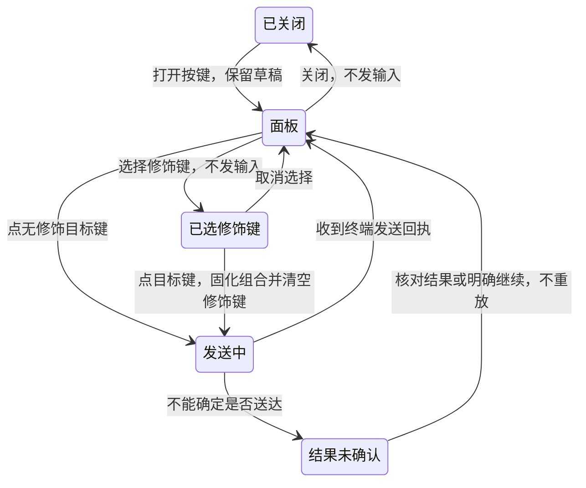

# 终端按键：调研、设计与实现

状态：**功能分支已实现，尚未发布**。调研日期 2026-10-19；代码基线
`7fc531ffd50b40d034771b220f427a03b25d0ed4`，本机 tmux 3.7c，Codex 源码
`rust-v0.163.0`。[English](terminal-keyboard-research.md)。
实现记录见 [OpenSpec 提案](../../openspec/changes/archive/2026-10-19-terminal-keyboard-input/proposal.md)。
已交付行为仍以[移动端](MOBILE.zh.md)、[网页](WEB.zh.md)、[五种形态](SURFACES.zh.md)
及 [HTTP 契约](../../api/contract.md)为准。

## 设计结论

增加一个统一的**按键**面板，支持导航键、F1–F12、快捷键字符，以及 Ctrl、Alt、Shift
组合。保留现有常用键栏，在键盘开关旁增加可见的「按键」入口；「查看问题」这类动作
只在核心取得当前场景证据时出现。

共享核心负责按键目录、组合规则和 tmux 编码，客户端按能力展示，agent 适配层提供操作
含义。已有按键类别中的新组合通常无需改发送链路；新增按键类别或 agent 特有动作仍可能
需要适配。这里支持的是有明确边界的终端键盘，不承诺转发操作系统上的所有按键。

## 调研范围与证据

主要用户是在手机上操作 coding agent 的人，同时考虑 iPad 和网页。面向下一轮实施，
并保留后续扩展空间。证据来自用户截图、代码、官方公开文档和一次隔离的字节实验。
没有安装或操作竞品，没有做用户可用性研究，也没有足够样本估计问题发生频率。

| 来源 | 已观察事实 | 我们的取舍 |
| --- | --- | --- |
| [Blink Smart Keys](https://docs.blink.sh/#smart-keys)、[自定义键盘](https://docs.blink.sh/basics/customize) | 附加键栏提供修饰键、导航及更多按键，支持按住修饰键连续组合。 | 借鉴分层展开；区分终端输入和 app 自身快捷键。 |
| [Prompt 键盘](https://help.panic.com/prompt/prompt-keyboard/) | 附加键栏可以打开可配置键盘，包含导航键和 F1–F16；页面日期为 2023-10-30。 | 借鉴明确可见的面板入口；不照搬常驻大键盘。此处是文档依据，不是当前 app 实机走查。 |
| [Termux 配置](https://github.com/termux/termux-tools/blob/master/termux.properties)、[发布记录](https://github.com/termux/termux-app/releases) | 附加键通过配置定义布局、弹出项，发布记录说明了修饰键锁定。 | 借鉴配置驱动；首期不做宏、仅靠滑动发现的入口或修饰键锁定。 |
| [Apple 按钮规范](https://developer.apple.com/design/human-interface-guidelines/buttons) | 强调可识别的按钮状态和足够的触控范围。 | 点击范围至少 44 × 44 pt；选中态除颜色外还有形状或文字及无障碍说明。 |
| [Codex 问题处理](https://github.com/openai/codex/blob/rust-v0.163.0/codex-rs/tui/src/chatwidget/questions.rs)、[键位](https://github.com/openai/codex/blob/rust-v0.163.0/codex-rs/tui/src/keymap.rs)、[问题状态](https://github.com/openai/codex/blob/rust-v0.163.0/codex-rs/tui/src/bottom_pane/async_questions/mod.rs) | 问题默认折叠；Shift+← 用于打开/切换问题，也能进入排队消息编辑；问题到达不抢焦点。 | 「查看问题」需要当前上下文；保留通用按键。不上来就强制展开，不增加 agent 状态。默认键位有版本和用户自定义边界。 |
| [tmux 手册](https://man.openbsd.org/tmux.1#send-keys)、[编码源码](https://github.com/tmux/tmux/blob/master/input-keys.c) | 命名键转为终端输入；不认识的名称可能变成普通文字；扩展键编码取决于应用模式。 | 采用结构化按键，统一验证和生成 tmux 名称，不直接透传任意字符串。 |

检索过 Termius，但没有核实到适合引用的当前官方键盘资料；第三方镜像手册未采用。
[tmux 修饰键 wiki](https://github.com/tmux/tmux/wiki/Modifier-Keys) 自己标明从 3.5 起
已经过时，因此不据它断言当前默认配置。以上不构成竞品普及率或优劣排名。

### 问题排序

| 优先级 | 用户目标与障碍 | 证据和可信度 | 设计回应 |
| --- | --- | --- | --- |
| P1 | 在手机打开 Codex 折叠问题，提示的组合键却没有按钮。 | 用户截图与源码，可信度高；只有这一报告，整体频率未知。 | 当前问题提示加通用按键面板。 |
| P1 | 使用 F2 或新组合，不想每次等待发版。 | 客户端固定键栏与服务端固定允许列表，代码证据明确。 | 按类别描述能力，复用同一发送链路。 |
| P1 | 真正发出按键，而不是把键名写进终端。 | tmux 3.7c 隔离实验明确；不是现有 HTTP 越权，现有允许列表会拦住未知键。 | 所有终端副作用前完成按键与组合校验。 |
| P2 | 需要更多键，但不想丢失终端视野或误带修饰键。 | 设计风险，未声称是实测到的现有缺陷。 | 分层面板、单次修饰键、保存草稿，后续用设备验收。 |

## 仓库现状

- `mobileapp/src/ui/Composer.tsx` 固定定义 Tab、方向键、回车、退格、Ctrl-C、Esc。
  点击时的触感是本地反馈，不代表远端已经收到。
- `internal/app/serve.go` 的 `allowedSendKeys` 是固定列表，没有 F2、BTab、S-Left；
  `sendToPane` 在校验命名键之前退出复制模式。
- `internal/tmux/tmux.go:SendKey` 把命名键作为参数交给 tmux。
- `internal/server/server.go:handleSend` 检查 host 同意、授权新鲜度和该访客链接自己的
  pane 输入权限；这仍是最终权限依据。
- 当前 API 已接收 `send_id`，但命名键分支在文字加回车的去重逻辑之前返回，不能把
  控制键重试描述为已经具备去重保障。

以上结论限于开头列出的代码基线。本轮不修改这些链路，也不扩展成输入安全全库扫描。

## 交互方案

### 常用栏和完整面板

保留现有常用键的相对顺序，在键盘开关后直接加入 **按键 / Keys**，避免用户先发现
横向滚动才看得到入口。不把十二个功能键塞到常用栏，也不按推测的使用频率自动重排。
「有 1 个问题 · 查看」作为输入框上方的紧凑提示，不形成新状态或另一整条常驻工具栏。

按键面板有目标窗格标题、关闭按钮、组合预览、**Ctrl / Alt / Shift** 三个修饰开关，
以及三个明确分类：

| 分类 | 内容 | 例子 |
| --- | --- | --- |
| 导航 | 四方向、Home、End、Page Up/Down、Insert、Delete、退格、Tab、Esc、回车、空格 | Shift + ← |
| 功能 | F1–F12，通常四列三行 | Ctrl + F2 |
| 字符 | A–Z、0–9、支持的 ASCII 快捷键符号 | Ctrl + K、Alt + B |

本地记住上次分类。首期不做键盘布局编辑器、最近使用或固定收藏；以后可以保存同一种
结构化按键，不需要改传输协议。字符按钮具有明确值，不把手机输入法的文字拆成逐键输入。

打开面板收起软件键盘，但保留当前窗格的草稿和附件。关闭时，仅当原输入框此前处于编辑
状态且目标未变才恢复焦点；看终端时不会突然弹键盘。面板按键作用于远端应用，不是手机
本地的滚动或选区。

### 单次修饰键

1. 点击 Ctrl / Alt / Shift 选中支持的组合，再点取消；选择本身不发任何输入。
2. 预览明确显示下一次操作，例如 **Ctrl + F2**。选中态带勾选/状态说明和无障碍播报。
3. 点击目标键发送一个事件；固化此次组合，立即清空修饰键，等待回执或失败前禁止连续发送。
4. 不支持的组合保留可见但禁用，并可读取原因。关面板、换窗格/服务器、进入后台或权限失效，
   都清空修饰状态且不发送。

首期不做锁定修饰键、长按连发、序列宏。用户仍可逐次点击形成操作顺序；遇到网络失败
不暗中积压后续按键，不离线重放。只有明确点击回车才发送回车，其他按键不附带回车，
也不顺手提交输入框原有的草稿。



结果未确认时仍可关闭面板、查看终端，但不继续发送后续事件。提供「查看终端」和
「不重试，继续操作」；只有 boot、上下文和回执保留期都允许安全重试，才提供同 ID 重试。
核对后恢复输入是用户明确操作，不会因此把此前按键改写成“确定没发出”。

### 反馈、布局与无障碍

沿用现有 `bg / surface / raised` 和文字 token；选中同时靠形状/文字和对比度，不增加
状态颜色。触感确认本地点按；成功回执说「**已发送到终端**」，不说 agent 已执行。
网络结果不明确时说「**结果未确认**」，保存此次精确按键，供确实可安全重试的路径使用。

手机用底部面板，高度随可用空间限制，内容可滚动，标题/关闭始终可达。iPad 用靠近输入区、
最大宽 480 pt 的面板；compact 布局退回手机形态。功能键通常四列，大字号不足则减少列数。
横屏、键盘变化不能靠缩小点击范围适配。VoiceOver 读出组合、选中态、禁用原因和发送结果，
关闭后回到「按键」入口。这些是后续验收要求，尚未做布局或语音验收。

## 支持范围和兼容边界

首期支持上述导航/编辑键、F1–F12、ASCII 快捷键字符，以及经过验证的 Ctrl / Alt / Shift
组合。目录按键公布允许的修饰组合，不把所有键和所有修饰键做无条件全排列。

| 结构化输入 | 核心生成的 tmux 表示 | 边界 |
| --- | --- | --- |
| F2 | `F2` | 不附加回车。 |
| Shift + ← | `S-Left` | 是 Codex 当前版本默认键位，不代表任何场景都表示打开问题。 |
| Shift + Tab | `BTab` | 别名集中处理。 |
| Ctrl + F2 | `C-F2` | 应用最终行为仍取决于它的键位。 |
| Alt + ← | `M-Left` | Alt 对应终端 Meta，不拆成另一条 Esc 请求。 |
| Shift + a | 编码器生成文字 `A` | 不生成不可靠的 `S-a`；数字/符号使用明确的最终字符。 |
| Ctrl + I / Ctrl + M | 传统模式下分别与 Tab / 回车同字节 | 明确提示等价，不承诺能区分。 |

区分 Ctrl+Shift+字母、Ctrl+数字、带修饰键的回车可能需要扩展键模式。核心无法确定并验证
目标 pane 模式时不宣称可用。F13–F24、小键盘、媒体键、Super/Cmd、系统保留快捷键不在
首期内。不改用户 tmux 配置、不强制扩展模式、不接管系统全局快捷键来制造“支持”。

## 共享架构与 API 提案

增加无 cgo 的叶子模块，暂名 `internal/terminalkeys`，统一负责目录、规范化、合法组合、
别名、兼容检查和 tmux 编码。现有常用栏、新面板与 agent 动作共用它。客户端负责布局、
图标和本地化，不另存一套权限或编码矩阵。

提供有认证且按 pane 检查可见权限的 `GET /api/input-capabilities?id=%N`，返回协议版本、
server boot、不可解释的 pane 绑定标记、`can_input`、规范键名、合法修饰组合；客户端说明不支持的组合。能力元数据不授予输入权。目录按版本/boot 缓存，进入窗格或重连时取当前目标信息，
写入时重新检查；不随着每帧终端轮询拉完整键盘目录。

为 `/api/send` 增加结构化 `key_event`。下面是协议示例；实际发送时须原样使用能力接口返回的当前上下文：

```json
{
  "id": "%42",
  "key_event": {"key": "F2", "modifiers": ["control"]},
  "input_context": {"boot": "<boot>", "pane_binding": "<opaque token>", "expires_at": 1792400000, "proof": "<opaque proof>"},
  "send_id": "<unique event id>"
}
```

规范键名采用 `ArrowLeft / Backspace / PageUp` 等、`F1`–`F12` 或明确的单个 ASCII 字符。
修饰名为 `control / alt / shift`，按这个顺序规范化；重复或未知值拒绝。请求在原有 `key`、
新 `key_event`、场景 `action`、原有文字形式中只能选一种；新事件不能混入文字或 `enter`。
保留原有合法请求，不重新解释旧文字，也不把被拒绝的按键降级成文字发送。
新按键/动作请求必须有 `send_id`；原有合法形式仍保留其可选行为。

服务端在退出复制模式或任何写入前，完成权限、同意、授权新鲜度、输入合法性和目标绑定
校验，临近注入再次核对身份。只有核心生成 tmux 参数；不开放原始字节、任意 tmux 名称/
命令、连发次数或 shell 片段。没有已验证 pane 路径的外部原生对话不会因此获得输入能力。

新事件链路须按调用方、boot、pane 绑定和载荷去重 `send_id`，包括并发重复请求；同一 ID
携带另一按键必须拒绝，返回缓存回执之前仍复查权限。回执存储有界，公布实际重试期限；
重试绑定原 boot，服务重启或回执过期后不重放结果不明确的按键。写入后、回执落存前崩溃
仍存在不确定窗口，不能承诺严格仅执行一次或自动重发。客户端对当前目标串行发送；失败
事件单独保留，不继续重放后续操作到不确定的界面状态。

认证/授权沿用 401/403；畸形或混合请求用 400；不支持组合用 422；上下文过期或同 ID 不同
载荷用 409。新客户端连接旧服务端时保留旧控制键，能力接口不存在不等于可以试发新键；
旧客户端连接新服务端仍可使用原有合法请求。

## Agent 专用含义

适配层可以提供动作 ID、本地化标签、结构化按键和新鲜度条件。**查看问题**只在当前确实
存在 Codex 问题且绑定可信时出现；点击只展开，不代选答案。没有问题就不显示这个动作，
通用 Shift+← 仍以按键原名可用。动作过期返回 409，避免误进入排队消息编辑。拟议动作
请求携带 `action: {id, revision}` 及相同输入上下文、发送 ID；核心重新解析，不能信任客户端
提交的动作和键位对应关系。

**已部署 harness 确实提供时**优先用专用 hook / 结构化问题事件。读到 Codex 内部问题状态
源码，不等于它已经有可供 gtmux 订阅的 hook 或只读接口。不支持或有已知问题时，可由核心
唯一适配器严格识别当前终端底部提示；不抓历史正文、不猜折叠的选项、不为查询另启
app-server 或 resume。键位未知或自定义无法核实时，收起场景动作，不假装默认键有效。
异步问题只是附加关注信息：agent 仍可能继续工作，不据此新增状态或直接判成阻塞 waiting。

原生回答卡、问题 ID 的完整消解、待回答推送、导入用户键位配置需另有证据，不是通用键盘
的前置条件，本提案也未把这些能力算作已实现。

## 五种形态

| 形态 | 范围 |
| --- | --- |
| terminal / 终端 CLI | 命名按键复用目录与编码；原始 attach 独立，本机键盘行为不变。 |
| menubar / 菜单栏 | 继续聚焦已绑定 pane，不再放一份完整键盘；未来场景动作仍消费核心证据。 |
| phone / 手机 | 按键面板、单次修饰键，有证据才展示问题入口。 |
| iPad | 共用数据与规则，适配面板；硬件键盘捕获另作显式开启的后续项，单独验收 IME 和系统快捷键。 |
| web / 网页 | 终端模式下使用同一屏幕按键目录和授权；不全局截获刷新、导航或文字编辑按键。 |

## 实验与验证边界

创建独立 socket、`/dev/null` 配置的临时 tmux server，由 raw PTY 接收器记字节。
以下按键仅送入隔离会话，结束后成功关闭该 server，没有启动 agent。

| 发给 tmux 的参数 | 收到的十六进制 |
| --- | --- |
| `F2` | `1b4f51` |
| `S-F2` | `1b5b313b3251` |
| `C-F2` | `1b5b313b3551` |
| `S-Left` | `1b5b313b3244` |
| `BTab` | `1b5b5a` |
| `C-M-Left` | `1b5b313b3744` |
| `C-i`、`Tab` | 各为 `09` |
| `C-m`、`Enter` | 各为 `0d` |
| `S-a` | `61`，是小写 a，并非大写 A |
| `NotAKey` | `4e6f74414b6579`，是键名原文；命令仍返回 0 |

这里只证明 tmux 3.7c 默认应用模式的字节表现，不是 gtmux API 测试、Codex 问题展开验收，
也不证明所有支持版本、手机、iPad 或网页 UI 可用。实施必须完成[任务中的验收矩阵](../../openspec/changes/archive/2026-10-19-terminal-keyboard-input/tasks.md)，
包括字节、权限、重试、大字号、VoiceOver 和实际 agent 行为。本提案尚未经过独立审查。


## 实现证据与剩余验证

实现采用以上设计：核心目录和编码器供 HTTP 与客户端共用；演示数据由核心生成，并有一致性检查。
私有原始终端回归覆盖目录声明的组合；这只证明基线输入字节，不代表每种 agent 都为每个键赋予功能。
字符组合使用经过校验的传统终端字节，避开 tmux 对 `M-;` 键名的歧义。
应用光标/扩展键模式、自定义键位、旧 tmux 版本仍有边界，不伪造增强字符组合。

[Codex 对应版本的 hook 注册表](https://github.com/openai/codex/blob/rust-v0.163.0/codex-rs/hooks/src/lib.rs)
列出十二种事件，但没有异步问题生命周期事件，因此本版采用窄范围页脚回退。
这不代表所有 Codex 结构化接口都没有问题信息，也不会为查询另开控制端。
核心只读当前 Codex 目标最后 18 行，要求问题计数、已识别的实时键位提示以及其后的输入框，注入前再次核对。
问题消失会拒绝；同数量的新问题、完全仿造页脚的终端输出，在没有原生问题 ID 时无法区分。
身份检查、读取和注入之间也存在小的非原子窗口。问题仅补充注意信息，不新增状态。

Web 和 iOS 的界面验收使用合成 HTTP/认证服务，验证按键请求、修饰键清除和终端回执，
没有中断真实 agent、回答真实问题或更换生产安装。实体键盘派发、VoiceOver 实际朗读、Android 运行态、
真实 Codex 问题打开效果仍未验证。作者自测不等于独立审查。
