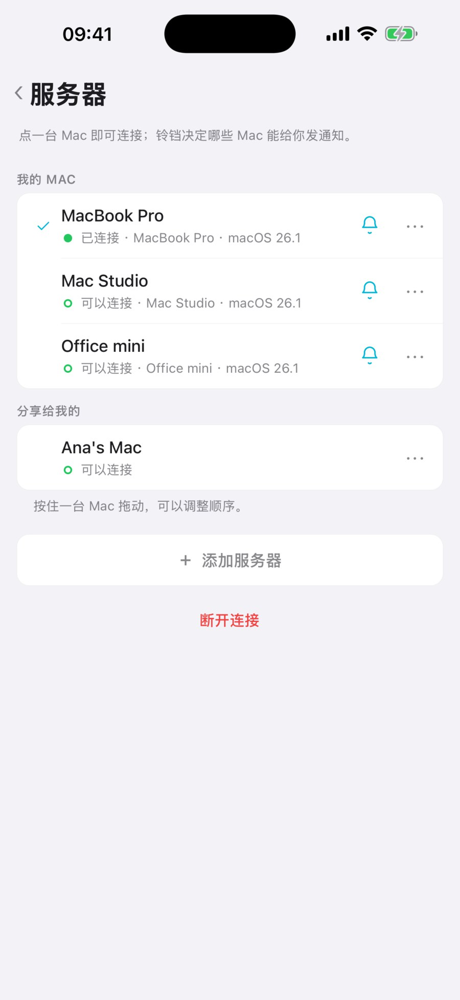
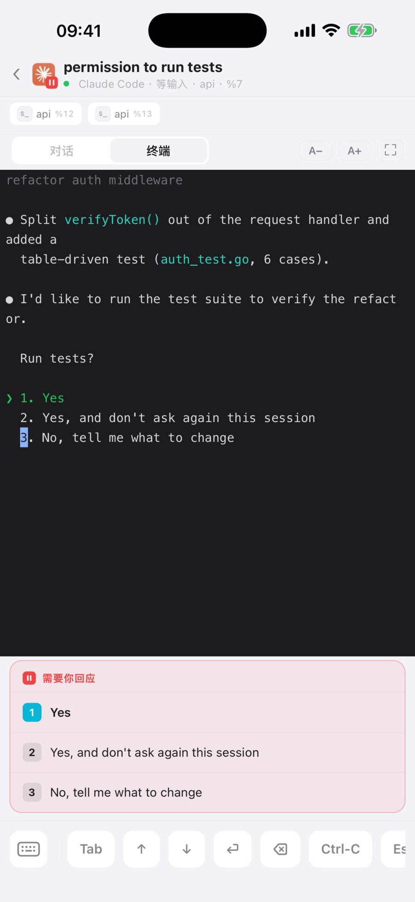
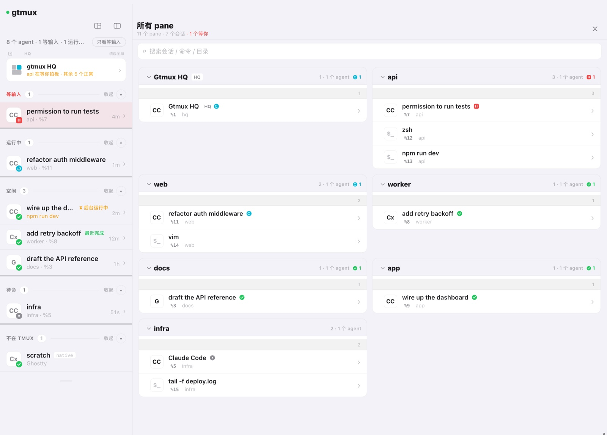
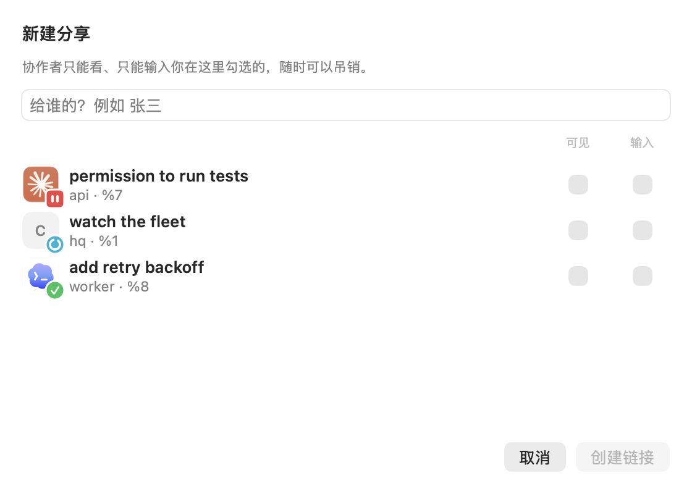

[English](phone-and-web.md) · **中文**

通过 iPhone、iPad 或浏览器，可以查看主机上的 agent 状态、阅读输出并回复。App 还提供 HQ 入口。本指南介绍设备配对、日常操作和 pane 分享。

## 先选 Pair 还是 Share

| 你想做什么 | 用哪个 | 权限 |
|---|---|---|
| 连接自己的 iPhone、iPad 或浏览器 | **Pair（配对）** | Mac 的 owner 权限，包括 HQ 和分享管理 |
| 让别人查看或协助一项任务 | **Share（分享）** | 只开放你选的 pane，可设为只读或允许输入 |

**自己的设备用 Pair；给协作者发 Share 链接。**

## 连接设备

先完成[首页三步](../../README.zh.md#安装并连接)：安装主机、运行 doctor、选择网络，再从 App Store 安装 App，使用「添加服务器 → 扫描配对二维码」。iPhone 和 iPad 使用同一个 App。配对成功后，主机会保存在服务器列表中，打开即可看到雷达。



添加另一台设备或浏览器时，在主机运行 `gtmux pair` 获取新码。每个码只能用一次，5 分钟过期；打开其中的浏览器链接即可配对自己的浏览器。主机要保持唤醒，雷达无法加载时按[连接排障](../phone.zh.md#排查连接问题)检查。

## 在 app 里操作

**iPhone：** 点一个 agent，查看对话或终端。需要回复时，点它给出的选项，或输入自己的回答；也能发控制键和截图。

在对话或终端顶部点显示图标即可调整字号，两种模式使用相同控件并共用字号设置。
终端另外提供「**自动换行**」（默认）／「**原始行宽**」。
前者按屏幕宽度折行；后者保留 Mac 的行宽，可左右滚动，适合看表格和代码差异。
外接大屏上的 tmux 窗格较宽时，行也会较宽；缩小窗格后，旧历史仍可能保留宽行。这个设置不会改变 Mac 窗格。
全屏时先退出全屏再调整。对话正文可用对话模式，Codex 截断的吸顶提示另有全文入口。

使用独立画面的终端程序只提供当前画面，更早的会话内容可在对话模式中查看。gtmux 不会把进入该画面前的旧输出接在前面。gtmux 直接创建或按标准流程恢复的 Codex 使用行内模式，保留后续终端历史。手动启动的会话可在下次启动时使用 `codex --no-alt-screen`，不要为同一段对话再开一个客户端。未写入终端缓冲区的旧画面无法补回。



**iPad：** 宽窗口下，雷达在侧栏，选中的会话在旁边主区显示，点另一行即可切换。窄窗口使用 iPhone 的布局。



打开 **HQ** 可以查看对话、态势板和知识库；点服务器名称可以切换 Mac。在已配对的 Mac 上点「**新建会话**」，会打开一个 shell 终端，再从那里启动 agent。

想在 agent 等你或跑完时收到通知，请允许 iOS 通知。Mac 要醒着、serve 要运行，送达还受网络和通知设置影响。访客连接不接收这些通知。

## 把一个 pane 开给协作者

在 Mac 菜单栏 app 打开「**偏好设置 → 分享 → 新建分享…**」。填一个名称，勾选对方「**可见**」的 pane，只在需要对方回复的 pane 上勾「**输入**」。创建链接后发给对方，对方可在浏览器打开，或在 iOS app 中兑换。



允许输入时，还要在分享设置里开启访客输入总开关。只读链接不需要输入权限；访客看不到 HQ 页面和 owner 管理功能。

终端里创建一个 24 小时后过期的只读链接：

```sh
gtmux share new --label alice --view %7 --expires 24h
```

把 `%7` 换成要分享的 pane（`gtmux panes` 可查看编号）。要让对方回复，创建时加上 `--type %7`，并开启 `gtmux share on`。能输入的访客可以操作 pane 里的程序，权限与程序本身相同。

## 结束访问

任务结束后，在分享设置中吊销访客链接，或用 `gtmux share revoke <id>`。已配对手机的「**设置 → 分享与配对**」也能管理访客链接。

自己的设备丢失时，要在 **Mac 上**吊销：`gtmux devices` 查看设备 ID，`gtmux devices revoke <id>` 移除访问权限。配对码和分享链接都不要公开。

---

选择连接方式或排查问题：[远程访问参考](../phone.zh.md)。想在另一台电脑上直接用终端：[从任意电脑接回会话](attach-from-anywhere.zh.md)。完整参数：[Pair](../cli.zh.md#gtmux-pair接入你自己的设备全权) · [Share](../cli.zh.md#gtmux-share给协作者的受限可吊销访问)。

## 区分已配对的设备

在 Mac **偏好设置 → 我的设备 · 配对** 中，点击设备旁的铅笔编辑名称。
例如，把两台 iPhone 分别标记为工作手机和个人手机。这只是 gtmux 中的显示名称，
不会修改设备的系统名称，也不需要重新配对。App 的已配对设备列表会显示同一名称。

iOS 通常只提供 iPhone/iPad 这样的通用名称。读取“ccy's iPhone”这类用户设定的名称，
需要 Apple 授予专门权限；gtmux 不会假设已经获得这项权限。浏览器统一显示为
**Browser**，并在可获取时显示浏览器名称、主版本和系统。这些是客户端信息，
不能用来确定硬件型号。旧设备若显示**暂无客户端信息**，重新连接后会更新，无需重新配对。

### 对话格式与回复操作

iPhone、iPad 和 Web 的对话模式都支持用户消息与 agent 回复中的 Markdown。App 中的长消息保留简短预览，展开后显示完整格式；正文仍可选择文字。

在 iPhone 和 iPad 上，回复下方的「**复制全文**」会复制这一轮回复的 Markdown 原文，包含已折叠的文字段落，不包含工具输出和用户提问。「**分享**」会打开系统分享面板。回复尚未结束时，复制或分享的是目前已收到的内容。

### 网页操作

宽屏工作台中，双击左侧会话即可打开，也可以拖入工作区。tmux 外的会话标注「**仅显示状态**」，不能作为终端窗格打开。窄屏工具栏会折行，普通 shell 的控件也能完整显示。

对话与终端输入框默认 Enter 换行，Ctrl/Cmd+Enter 发送，也可在设置中开启回车发送。输入法选字时，Enter 只确认候选词，不发送。对话中的中间回复和工具详情会随内容更新。

访问权限被撤销后，网页返回访问页并停止读取旧会话。输入新的配对码或分享码即可重连，只恢复该凭证有权查看的 pane。

<a id="浏览器本机工作台与轨迹" data-doc-heading="网页操作"></a>

menubar 面板底部的「打开本机工作台」会直接打开 `http://127.0.0.1:8765`，使用一次性配对码认证，无需 tunnel。服务未启动时，App 只启动监听本机回环地址的子进程，退出 App 时停止；已有远程服务则直接复用，不改动其配置。在 App 内切换远程访问时，会先释放本机子进程的端口，再启动托管服务。不在 tmux 中的会话继续以「仅显示状态」展示。

工作台和独立对话页统一显示 Agent 头像、HQ 角色标识、消息复制图标（悬停显示名称，操作成功后短暂显示勾号）和可展开的工具调用摘要。对话与终端均可按权限输入；刷新对话或切换这两种视图不会丢失草稿，各窗格的文字草稿分别保存在当前浏览器中，按服务和访问身份隔离。

复制图标位于消息下方，与发送时间、来源一起显示。会话和布局操作支持键盘，Esc 可关闭布局菜单和设置面板。

Agent 工作时，对话输入框上方会显示「**正在处理**」。点击「**展开实时输出**」可查看当前终端的最新内容，也可以收起继续阅读。每个窗格会记住展开状态，工作结束后状态条自动消失；服务端提供有效开始时间时，还会显示运行时长。实时更新保留草稿和阅读位置，读取失败会提示并自动重试。

网页直接点击对话／终端旁的「轨迹」；App 从「会话工具」打开「轨迹」，可按记录顺序查看用户输入、Agent 回复和工具调用，支持搜索、事件类型筛选、选中详情和复制。顶部色块按事件顺序排列。工具详情是已记录的参数摘要，此视图不包含模型请求耗时、Token 数、完整原始参数或工具输出。

发送按钮使用向上箭头，控制栏中的回车键用于直接向终端发送 Enter。输入框支持展开撰写、终端控制键、历史输入和常用语。

照片、文件、粘贴的图片和拖入的文件会先放入待发送列表，图片可标注。点击发送才会上传，并显示进度；失败后保留文字与附件。重新加载页面会保留文字，附件需要重新选择。历史输入与常用语只填入输入框，不会直接发送。

点击消息中的用户、Agent 或 HQ 头像，可查看身份和已有的会话信息。历史消息按记录展示身份，不补猜个人资料。可输入的会话直接显示输入框，不再重复显示权限标签；只读会话保留说明。

### Codex 的终端历史与标题

手动启动 Codex 时，可使用 `codex --no-alt-screen`（开头是两个短横线）。恢复已有对话时，先退出旧客户端，再用 `codex --no-alt-screen resume <SESSION_ID>` 启动，并保留原来的模型、effort 和权限参数。这能保留后续终端滚动历史，无法补回已经覆盖的旧画面。`/raw` 只调整显示方式，不能直接替代这个启动参数。详见 [Codex 特殊处理](../design/CODEX.zh.md) 和[官方命令说明](https://learn.chatgpt.com/docs/developer-commands?surface=cli)。

tmux 会话显示的是终端标题。Codex 若把项目或目录放进标题，例如「检查改动 | project」，gtmux 会保留这一部分，手机端没有另外拼接。标题组成由 Codex 的 `tui.terminal_title` 配置控制；tmux 外的会话则优先使用记录中的对话名称。因此并非所有 Codex 标题都会带目录，也不能仅凭 `|` 就删除后半段。参见[官方配置说明](https://learn.chatgpt.com/docs/config-file/config-reference)。

### 外观与轨迹详情

点击浏览器右上角的设置齿轮，在「外观」中可选择「跟随系统」「浅色」「深色」，默认跟随系统并记住当前浏览器的选择。终端内容保留服务端终端配色。轨迹右侧的详情可关闭，关闭后列表占满宽度并展示更长摘要；点击条目或「显示详情」可重新打开，刷新不会自动展开。

macOS 两个配对入口现在显示相同的连接状态、App 扫码提示、完整浏览器链接、终端命令和配对码倒计时/刷新操作。
