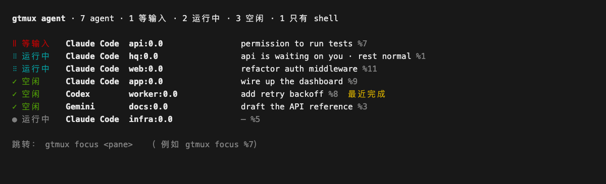

[English](watch-a-fleet.md) · **中文**

完成[安装和 doctor 配置](../../README.zh.md#安装并连接)后，按本指南启动 agent、查看状态及恢复会话。

## 每个 agent 跑在自己的 tmux pane 里

每个 agent 使用独立的 tmux pane，才能通过 gtmux 跳转和回复。tmux 外的 agent 也可通过 hook 提供只读状态。安装并登录 agent CLI 后，先创建一个命名会话：

```sh
tmux new -s api 'claude'
```

按 `Ctrl-b d` 脱离这个会话，或者另开一个终端窗口，再起下一个：

```sh
tmux new -s docs 'codex'
```

关闭终端窗口、断开 SSH 或拔掉显示器后，tmux 会话和其中的 agent 仍可继续运行。会话名称和 pane ID 用于定位各个 agent。

重启后，`gtmux restore` 从最近保存的 tmux-resurrect 快照重建会话和布局；程序会作为新进程启动，支持恢复对话的 agent 默认续接原对话。`gtmux doctor` 可配置快照保存。

MacBook 合盖默认休眠，`gtmux awake on` 可让它继续运行。tmux 基础操作见官方 [Getting Started](https://github.com/tmux/tmux/wiki/Getting-Started)。

## 让 agent 上雷达

每种使用的 agent 安装一次 hook，直接报告回合和审批状态。Copilot 和 Kiro 需要 hook 才能出现在雷达上；部分其他 agent 也能从进程和屏幕识别：

```sh
gtmux install hooks --agent claude
gtmux install hooks --agent codex
```

不加 `--agent` 只配 Claude Code。你用哪些就接着配哪些：`gemini`、`cursor`、`opencode`、`kimi`、`copilot` 或 `kiro`。已经在跑的 agent 重启后才会用上 hook。`gtmux doctor --fix` 会为本机已安装且受支持的 agent 提出 hook 配置，也可用 `gtmux install hooks --agent auto`。各自的加载要求见 [Agent 接入](agent-integrations.zh.md)。

支持进程识别的 agent 不装 hook 时，gtmux 从 pane 标题、屏幕和 CPU 采样读取回退状态，细节少一些（Codex 正在弹的审批菜单仍会显示为等待）。tmux 外的可见范围取决于各 agent 的 hook 和历史读取支持。

## 打开雷达

```sh
gtmux agents --watch      # 终端里的实时看板；↑/↓ 选择，回车跳过去
```

或者让它常驻：菜单栏 app（安装脚本会一起装，也可以 `brew install --cask chenchaoyi/tap/gtmux-app`）在菜单栏放一个状态点，`⌘⌥G` 唤出面板，有 agent 等你时发通知。iPhone 和 iPad app 上是同一块雷达，见[用手机和网页远程管理](phone-and-web.zh.md)。



## 查看所有 pane

`gtmux panes` 列出所有 tmux pane，包括 agent、shell、编辑器和开发服务器。App 中对应的入口是「所有 pane」。


## 跳到在等你的那个

```sh
gtmux focus %7            # 把那个 pane 所在的窗口和 pane 带到最前
```

点击菜单栏中的 agent 或通知，也能将对应的终端窗口和 pane 切到前台，然后输入回复。跳转支持 Ghostty 1.3+、iTerm2 和 cmux；Warp 为尽力支持。tmux 还需开启 `set-titles`，可通过 `gtmux doctor` 配置（[`gtmux focus`](../cli.zh.md#gtmux-focus)）。

Mac 上按 ⌥⌘4 可截图发给 agent。已展开的菜单栏面板会保留在截图里，可以直接框选面板本身；按 Esc 取消后仍保持展开。编辑页的附言框支持回车换行，⌘↩发送；调整窗口时，截图和标注一起等比缩放，导出仍保留原始像素尺寸。

---

相关指南：[使用 HQ 协调任务](hq-supervisor.zh.md) · [用手机和网页远程管理](phone-and-web.zh.md) · [CLI 参考](../cli.zh.md#gtmux-agents)
